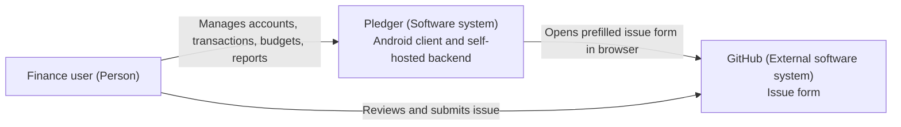
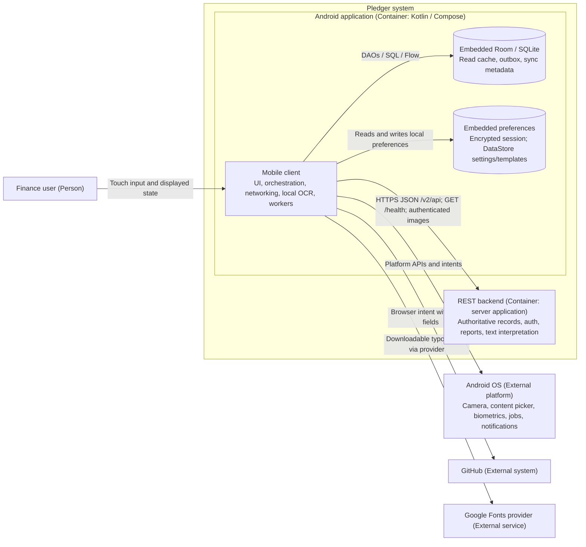
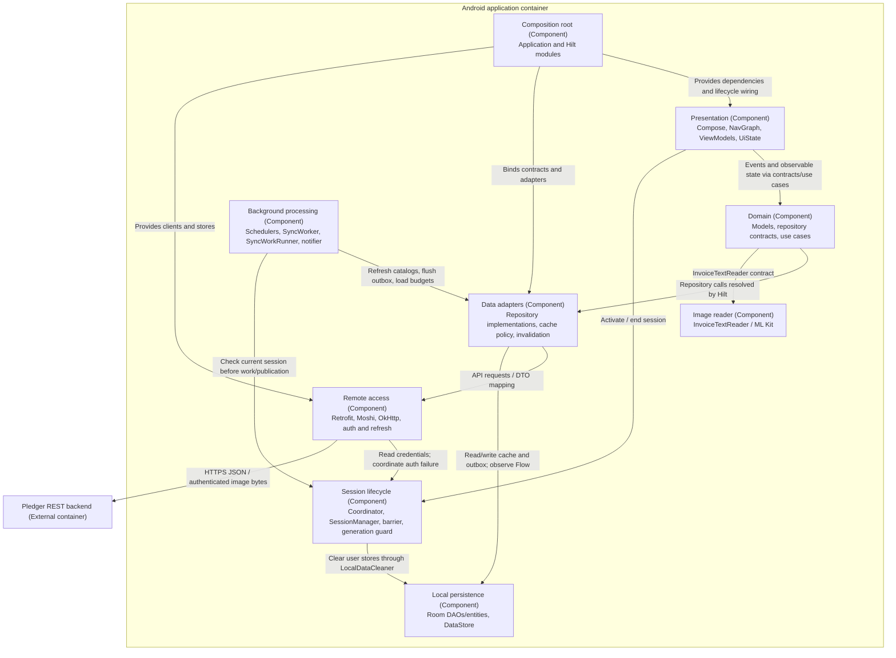

# Architecture: C4 views

Pledger.io Android is a Kotlin client for a user-configured Pledger REST server. The views below describe the checked-in application. Diagrams use Mermaid with explicit C4 element types and labeled relationships. Embedded databases and packages are not independently deployed services.

## Level 1: system context

Scope: the Pledger personal-finance system as used from Android. The person chooses and trusts a self-hosted server, manages finances, and reviews any issue report before submission.

Pledger's server is authoritative for financial records and authentication. The Android client does not connect directly to banks. Backend internals, server administration, and banking integrations are outside this repository's scope.

## Level 2: containers

Scope: the Pledger software system. The APK and backend are separate deployment/runtime units. Stores shown inside Android are embedded implementation details, not additional C4 containers.

Room schema v7 holds accounts/types, transactions, budgets, expense groups, categories, tags, contracts, currencies, sync metadata, and pending transaction creates. Room is mainly a read cache; the outbox is durable local intent awaiting server acceptance. In-memory report/insight caches are lost on process death.

`SessionManager` stores session material using EncryptedSharedPreferences; DataStore holds user preferences and transaction templates. Token encryption does not imply Room or image-cache encryption. Local OCR reads images on-device; extracted text is sent to the configured backend for interpretation. The shared OkHttp stack also authenticates Coil logo requests.

The configured host is a trust boundary. `DynamicBaseUrlInterceptor` replaces scheme, host, and port; it does not prepend a reverse-proxy path prefix. Release transport requires HTTPS. See [constraints](CONSTRAINTS.md) for storage, session, and offline limits.

## Level 3: Android components

Scope: internals of the Android application container. Arrows show runtime collaboration; source dependencies use domain contracts, with Hilt binding implementations. Packages provide conventions within one Gradle module, not compiler-enforced module isolation.

Compose screens render ViewModel `StateFlow` and send user events. ViewModels use repository contracts directly for simple operations and use cases for orchestration. Models and interfaces live under `domain`; Retrofit DTOs and Room entities are mapped in `data`. A compatibility bridge remains between `util.Resource` and `domain/common/Resource`; package boundaries are a design intent rather than a claim of perfect isolation.

Repositories choose caching by operation. Reference catalogs use Room observation with TTL metadata and stale-while-revalidate refresh (`CacheRefresher`). Paged transactions/counterparties use network requests and bounded cached fallback. Reports use domain store contracts backed by in-memory caches. Successful transaction changes invalidate derived budget/report data and owned-account balances through `TransactionMutationInvalidator`.

### Authentication and session flow

1. Server setup validates `/health` and stores the address; login posts credentials to the server.
2. A JWT with `PRE_VERIFICATION_USER` enters `PendingMfaSession` in memory. The OTP screen verifies TOTP before activating a full session. Process death requires password login again.
3. `AuthenticatedSessionCoordinator` coordinates session transitions, cleanup, and sync scheduling. Session generation and `SessionDataBarrier` prevent old background work from publishing into a new session.
4. `AuthInterceptor` attaches Bearer credentials and `TokenRefresher` handles refresh using a separate qualified refresh client. Explicit verification Authorization must survive interception.
5. Logout/server changes invalidate background work and clear user caches, templates, outbox, report/insight caches, and images. Authentication reset preserves the configured server where appropriate.

Durable API tokens managed in Settings are separate credentials from the device's interactive JWT session. See [ADR-020](adr/020-api-token-sessions.md) and [ADR-021](adr/021-mfa-enroll-verify.md).

### Transaction create form

Income is `DEBIT` (debtor to owned account); expense is `CREDIT` (owned account to creditor); transfers use owned accounts on both sides. The server account catalog controls ownership/type choices. Guided/Power changes defaults, not available capabilities.

Invoice flow: camera/image picker -> `InvoiceTextReader` local OCR -> `ProcessInvoiceScanUseCase` -> backend text extraction -> prefilled transaction form -> user review -> normal submit. OCR success alone never saves a transaction.

### Offline create and synchronization

Eligible creates can be stored in Room's outbox when offline or after an I/O failure. The transaction list observes pending entries and supports discard. Reconnect scheduling and periodic work attempt delivery under the current session generation. Offline edit/delete/split PATCH and offline creation of missing accounts are outside this queue.

Outbox delivery claims rows as `IN_FLIGHT` before POST. Unknown outcomes are reconciled against server transactions before reposting; successful delivery caches the record, invalidates derived data, and removes the pending row. Permanent errors produce failed entries; transient errors stop/requeue according to retry rules. This is a client-side duplicate mitigation, not a server-guaranteed exactly-once protocol.

`SyncWorkScheduler` schedules connected periodic work every 12 hours. `SyncWorkRunner` refreshes catalogs/accounts, flushes pending creates, and loads budget data while checking session validity. `SyncWorker` classifies outcomes and publishes alerts only for the current generation. Preferences control alert enablement and threshold; fingerprints suppress repeated alert sets. `BudgetAlertNotifier` opens the relevant budget month via a `pledger://budgets` pending intent. Android scheduling and notification permission govern actual execution/display.

## Code map

C4 level 4 is represented by these implementation entry points rather than a duplicate class diagram. Paths are relative to this document.

| Responsibility | Source |
|---|---|
| Startup / Hilt / workers | [Application](../app/src/main/java/com/pledgerio/app/PledgerApp.kt), [DI modules](../app/src/main/java/com/pledgerio/app/di) |
| Navigation and deep links | [NavGraph](../app/src/main/java/com/pledgerio/app/ui/navigation/NavGraph.kt), [DeepLinkParser](../app/src/main/java/com/pledgerio/app/ui/navigation/DeepLinkParser.kt) |
| Transaction orchestration | [Form ViewModel](../app/src/main/java/com/pledgerio/app/ui/transactions/TransactionFormViewModel.kt), [domain use cases](../app/src/main/java/com/pledgerio/app/domain/usecase) |
| API / authenticated networking | [PledgerApiService](../app/src/main/java/com/pledgerio/app/data/remote/api/PledgerApiService.kt), [NetworkModule](../app/src/main/java/com/pledgerio/app/di/NetworkModule.kt) |
| Storage / migrations | [PledgerDatabase](../app/src/main/java/com/pledgerio/app/data/local/PledgerDatabase.kt), [migrations](../app/src/main/java/com/pledgerio/app/data/local/PledgerDatabaseMigrations.kt) |
| Outbox delivery | [TransactionOutboxRepositoryImpl](../app/src/main/java/com/pledgerio/app/data/repository/TransactionOutboxRepositoryImpl.kt) |
| Session isolation | [AuthenticatedSessionCoordinator](../app/src/main/java/com/pledgerio/app/util/AuthenticatedSessionCoordinator.kt), [SessionDataBarrier](../app/src/main/java/com/pledgerio/app/util/SessionDataBarrier.kt) |
| Sync and alerts | [SyncWorkRunner](../app/src/main/java/com/pledgerio/app/util/SyncWorkRunner.kt), [BudgetAlertNotifier](../app/src/main/java/com/pledgerio/app/util/BudgetAlertNotifier.kt) |
| Read caching | [CacheRefresher](../app/src/main/java/com/pledgerio/app/data/cache/CacheRefresher.kt), [report cache](../app/src/main/java/com/pledgerio/app/data/cache/ReportsOverviewCache.kt) |

See [constraints](CONSTRAINTS.md), [ADRs](adr/README.md), and [features](FEATURES.md). Historical plans are indexed in [documentation home](README.md).
